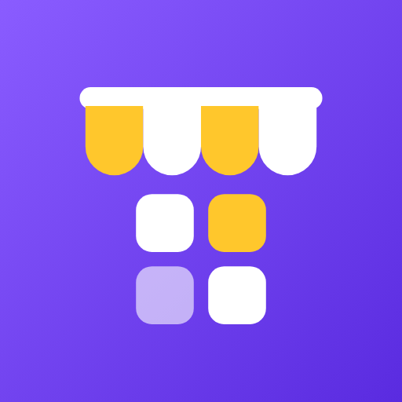
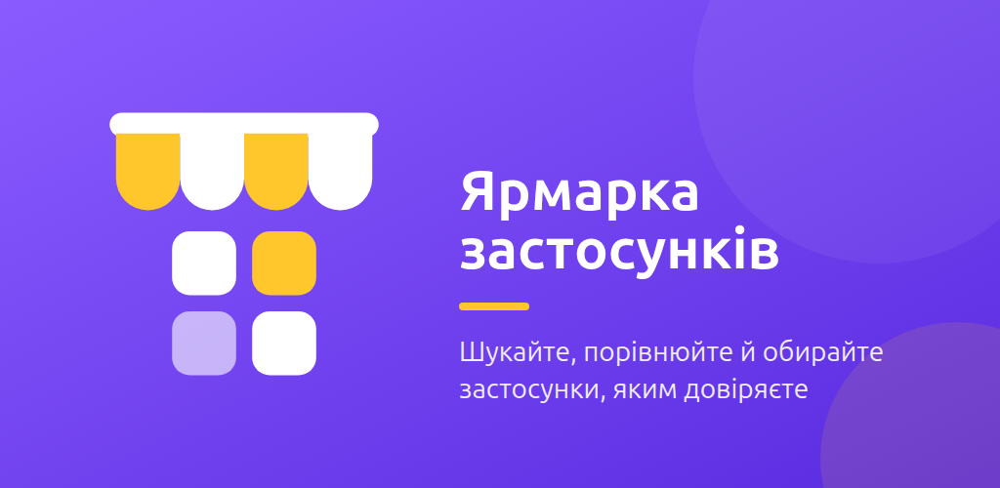
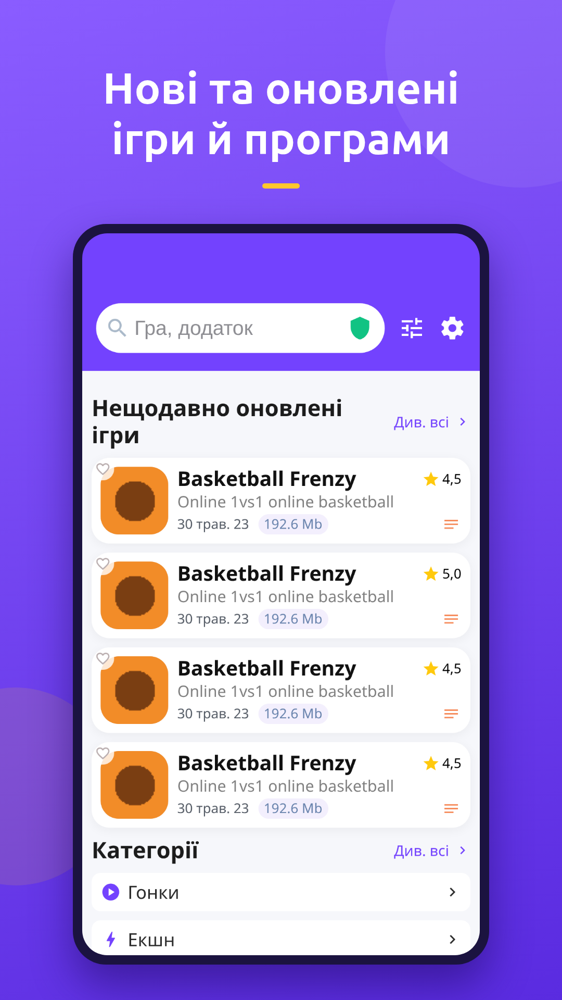
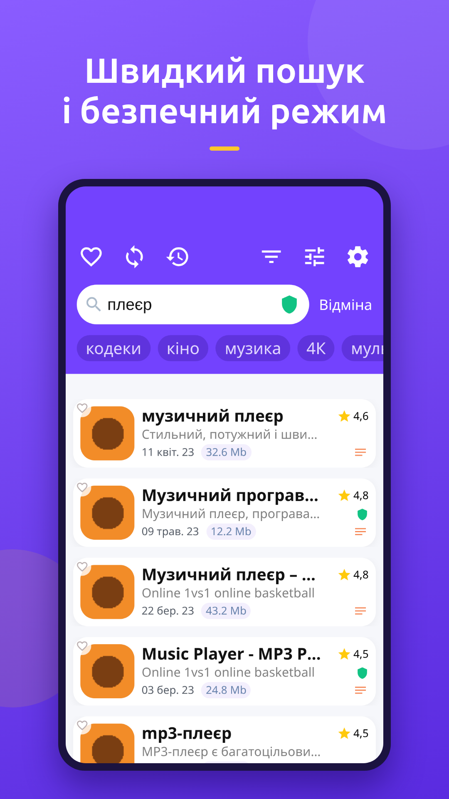
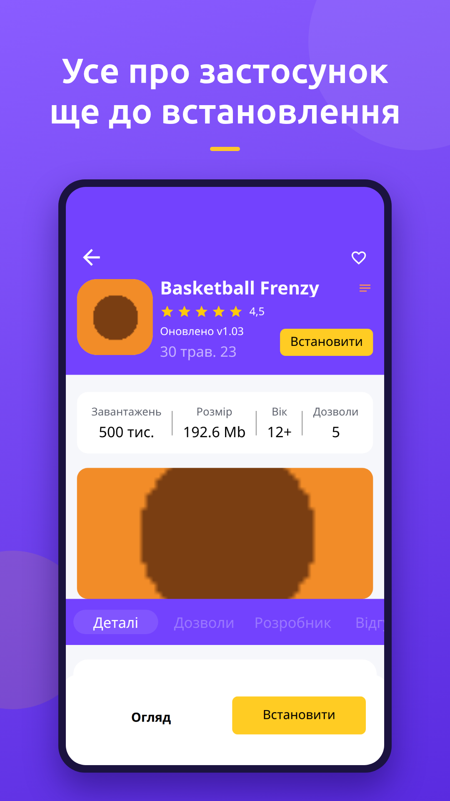
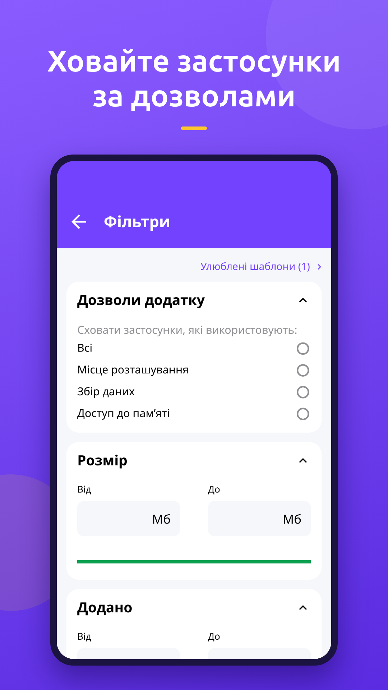
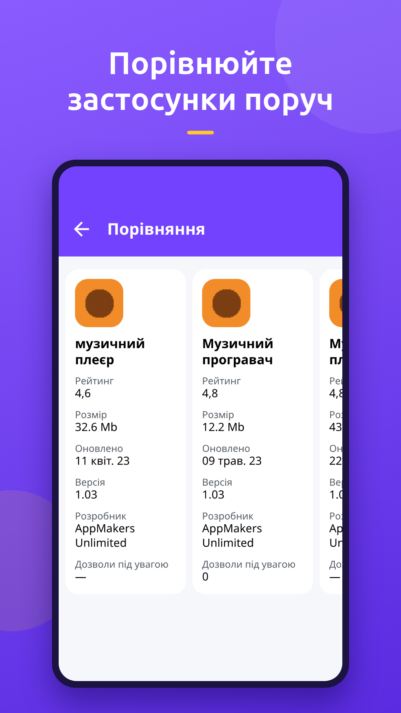
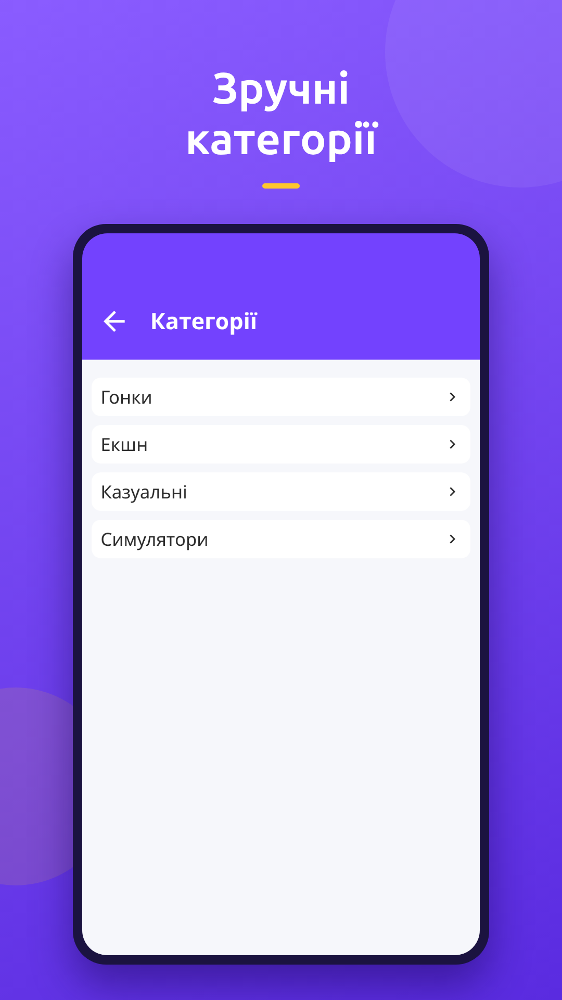
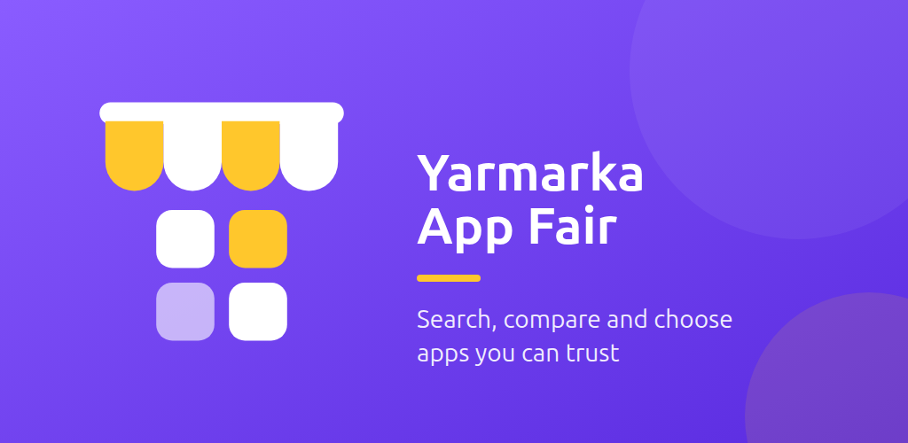

  

<h1 align="center">Ярмарка застосунків</h1>

  Каталог програм та ігор для Android з фільтрами дозволів і безпечним режимом.

  <a href="https://play.google.com/store/apps/details?id=com.kailuas.yarmarka">Google Play</a> ·
  <a href="../../releases/latest">Завантажити APK</a> ·
  <a href="../../issues/new/choose">Повідомити про проблему</a> ·
  <a href="#english">English</a>

Ярмарка застосунків допомагає побачити, чого саме хоче програма, ще до встановлення.

## Можливості

**Швидкий пошук**
- Пошук за назвою з підказками та історією запитів
- Категорії ігор і програм, добірки нещодавно оновлених
- Сортування за оцінкою, датою оновлення, датою додавання чи кількістю дозволів

**Фільтри за дозволами**
- Приховуйте застосунки, які просять доступ до місцезнаходження, збирають дані чи читають сховище
- Фільтри за ціною, оцінкою, розміром, віковим рейтингом, кількістю завантажень і датою
- Зберігайте улюблені набори фільтрів як шаблони

**Безпечний режим**
- Позначки безпечних і небезпечних застосунків просто у списку
- Блокуйте окремі застосунки або всіх застосунків розробника

**Порівняння**
- Детальна сторінка: скриншоти, опис, дозволи, розробник, відгуки
- Порівняння кількох застосунків поруч: оцінка, розмір, версія, дозволи
- Улюблені, нотатки й групові дії над вибраними

## Скриншоти

| Каталог | Пошук | Сторінка застосунку |
|:---:|:---:|:---:|
|  |  |  |
| **Фільтри** | **Порівняння** | **Категорії** |
|  |  |  |

## Встановлення

**Google Play (рекомендовано).** Встановіть з [Google Play](https://play.google.com/store/apps/details?id=com.kailuas.yarmarka). Оновлення приходитимуть автоматично.

**APK.** Якщо Google Play недоступний:
1. Відкрийте [останній реліз](../../releases/latest) і завантажте файл `yarmarka-<версія>.apk`.
2. Відкрийте файл на телефоні та дозвольте встановлення з цього джерела, якщо Android попросить.

> Версії з Google Play і з APK можуть мати різний підпис. Щоб перейти з однієї на іншу, спершу видаліть встановлену версію.

## Зворотний зв'язок

- **Знайшли помилку?** [Створіть issue](../../issues/new?template=bug_report.yml) і вкажіть версію застосунку та модель телефона.
- **Маєте ідею?** [Запропонуйте покращення](../../issues/new?template=feature_request.yml).
- **Питання й обговорення** ведіться в [Discussions](../../discussions).

Перш ніж створювати issue, перевірте, чи немає вже схожого серед [наявних](../../issues).

## Історія версій

Список змін кожної версії є у [Releases](../../releases).

> Вихідний код застосунку не публікується. Тут лише релізи, опис і трекер проблем.

---

## English

**Yarmarka: App Fair** is a catalog of Android apps and games that makes it easy to search, compare and pick only what you trust. It shows what an app wants before you install it.

- **Search fast:** suggestions, query history, categories, sorting by rating, update date or number of permissions.
- **Filter by permissions:** hide apps that want your location, collect data or read your storage. Save filter sets as templates.
- **Safe mode:** safe and unsafe labels in the list. Block single apps or a whole developer.
- **Compare and choose:** a detailed app page, side-by-side comparison, favorites, notes and bulk actions.

**Install** from [Google Play](https://play.google.com/store/apps/details?id=com.kailuas.yarmarka), or download the APK from the [latest release](../../releases/latest).

**Feedback:** [report a bug](../../issues/new?template=bug_report.yml), [suggest a feature](../../issues/new?template=feature_request.yml), or ask in [Discussions](../../discussions). Issues may be written in Ukrainian or English.

