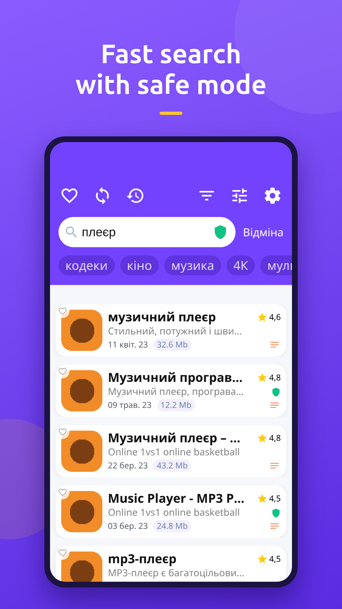
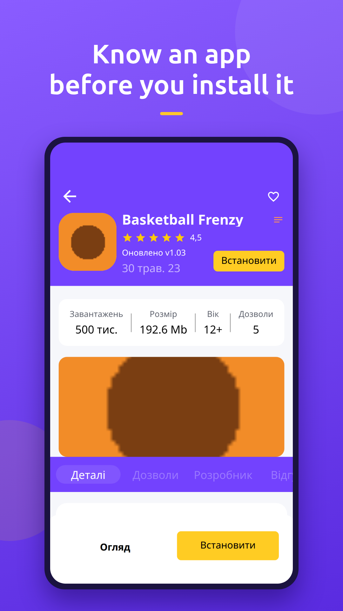
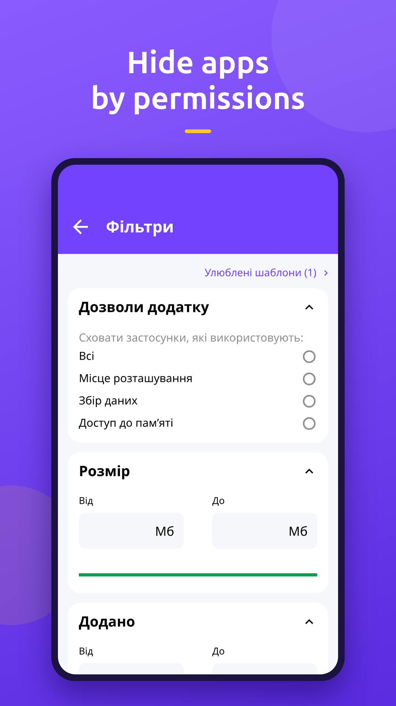
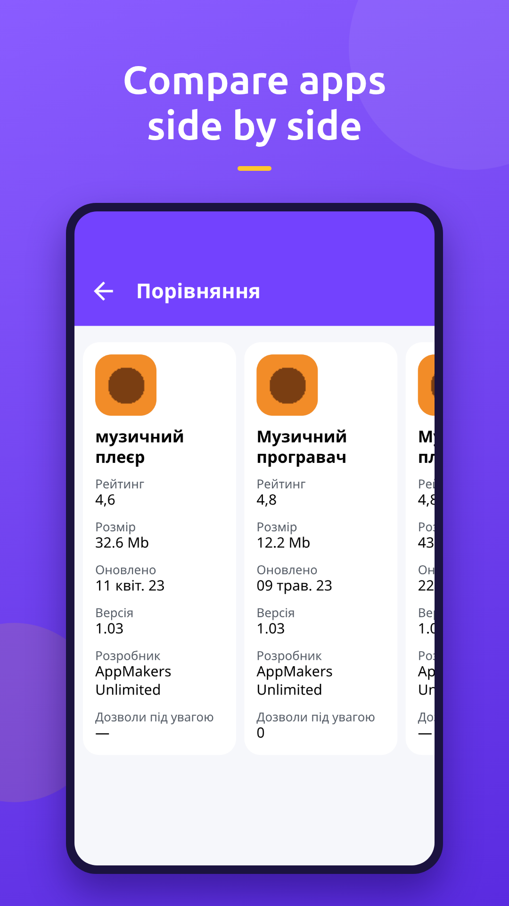

  

<h1 align="center">Yarmarka: App Fair</h1>

  A catalog of Android apps and games with permission filters and a safe mode.

  <b>English</b> · <a href="README.uk.md">Українська</a>

  <a href="https://play.google.com/store/apps/details?id=com.kailuas.yarmarka">Google Play</a> ·
  <a href="https://github.com/llmdevstudio/yarmarka-apps/releases/latest">Download APK</a> ·
  <a href="https://github.com/llmdevstudio/yarmarka-apps/issues/new/choose">Report a problem</a>

Yarmarka shows what an app wants before you install it.

## Features

**Search fast**
- Search by name with suggestions and query history
- Game and app categories, recently updated picks
- Sort by rating, last update, date added or number of permissions

**Filter by permissions**
- Hide apps that want your location, collect data or read your storage
- Filter by price, rating, size, age rating, downloads and dates
- Save your favorite filter sets as templates

**Safe mode**
- Safe and unsafe labels right in the list
- Block single apps or every app from a developer

**Compare and choose**
- Detailed app page: screenshots, description, permissions, developer, reviews
- Compare several apps side by side: rating, size, version, permissions
- Favorites, personal notes and bulk actions on selected apps

## Screenshots

| Browse | Search | App details |
|:---:|:---:|:---:|
|  |  |  |
| **Filters** | **Compare** | **Categories** |
|  |  |  |

## Install

**Google Play (recommended).** Install from [Google Play](https://play.google.com/store/apps/details?id=com.kailuas.yarmarka) to get updates automatically.

**APK.** If Google Play is not available:
1. Open the [latest release](https://github.com/llmdevstudio/yarmarka-apps/releases/latest) and download `yarmarka-<version>.apk`.
2. Open the file on your phone and allow installs from this source if Android asks.

> The Google Play and APK builds may be signed differently. To switch between them, uninstall the installed one first.

## Feedback

- **Found a bug?** [Open an issue](https://github.com/llmdevstudio/yarmarka-apps/issues/new?template=bug_report.yml) with the app version and your phone model.
- **Have an idea?** [Suggest a feature](https://github.com/llmdevstudio/yarmarka-apps/issues/new?template=feature_request.yml).
- **Questions** go to [Discussions](https://github.com/llmdevstudio/yarmarka-apps/discussions).

Please check the [existing issues](https://github.com/llmdevstudio/yarmarka-apps/issues) first. Issues may be written in English or Ukrainian.

## Changelog

Changes for every version are listed in [Releases](https://github.com/llmdevstudio/yarmarka-apps/releases).

> The app's source code is not published. This repository holds releases, the description and the issue tracker.
